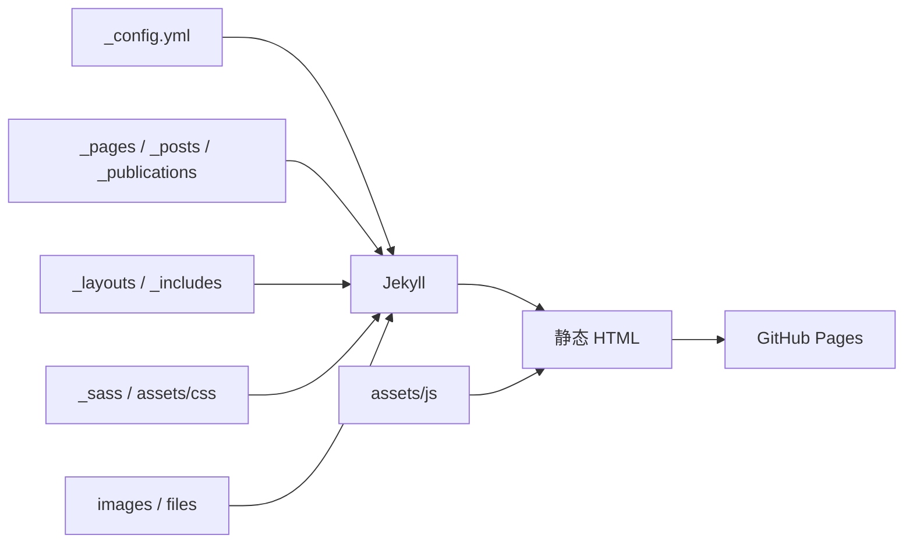

# 项目目录与文件功能说明

> 本文根据当前仓库文件生成，覆盖站点源码、内容、资源、附件以及被 Git 忽略的本地工作目录。新增文件时建议同步更新本文。

## 1. 渲染与发布链路

Jekyll 读取配置、页面集合、模板、样式和资源，生成静态网站；GitHub Pages 负责发布生成结果。`local/` 与 `markdown_generator/` 只保存本地检查或内容生成材料，不参与线上页面渲染。

## 2. 根目录文件

| 文件 | 功能 |
| --- | --- |
| [`README.md`](../README.md) | 当前项目说明、网站入口、运行方式和维护约定。 |
| `README.legacy.md` | 旧版 README 的历史存档；已加入 `.gitignore`，仅供参考。 |
| [`.gitignore`](../.gitignore) | 忽略 Jekyll 构建缓存、依赖、编辑器文件、个人备份和本地实验材料。 |
| [`_config.yml`](../_config.yml) | Jekyll 全局配置：站点信息、作者资料、集合、默认布局、Markdown 解析和构建排除项。 |
| [`Gemfile`](../Gemfile) | 声明 Jekyll、GitHub Pages、Feed、Sitemap、重定向和相关 Ruby 依赖。 |
| [`package.json`](../package.json) | 声明前端 Node 依赖和 JavaScript 压缩/监听脚本。 |
| [`LICENSE`](../LICENSE) | MIT 许可证和版权声明。 |

## 3. 页面与内容目录

### `_pages/`：独立页面

| 文件 | 功能 |
| --- | --- |
| [`about.md`](../_pages/about.md) | 首页 `/`，展示个人简介、教育经历、研究方向和联系方式。 |
| [`publications.html`](../_pages/publications.html) | `/publications/`，按论文类别渲染 publications 集合。 |
| [`blog.html`](../_pages/blog.html) | `/blog/`，按年份、月份和日期渲染博客时间轴。 |
| [`honors-and-awards.md`](../_pages/honors-and-awards.md) | `/honors-and-awards/`，展示奖项和竞赛经历。 |
| [`interests.md`](../_pages/interests.md) | `/interests/`，展示摄影、运动、音乐和 Formula 1 等兴趣内容。 |
| [`page-archive.html`](../_pages/page-archive.html) | `/page-archive/`，提供页面归档。 |
| [`tag-archive.html`](../_pages/tag-archive.html) | `/tags/`，按标签汇总文章。 |
| [`sitemap.md`](../_pages/sitemap.md) | 输出站点地图页面/文件入口。 |
| [`404.md`](../_pages/404.md) | 自定义 404 页面。 |
| `category-archive.html` | 可选分类归档，目前被 `.gitignore` 忽略。 |

### `_posts/`：博客文章

每个文件都是一篇 Jekyll 博客文章，文件名使用日期前缀；文章正文集中记录 Markdown、Git、线性代数、机器学习、计算机视觉、深度学习、序列模型和 Transformer/BERT 等学习内容。

| 文件 | 主题 |
| --- | --- |
| [`2021-09-13-blog-markdown-learning.md`](../_posts/2021-09-13-blog-markdown-learning.md) | Markdown 快速入门 |
| [`2021-09-15-blog-git-learning.md`](../_posts/2021-09-15-blog-git-learning.md) | Git 快速入门及在线协同 |
| [`2021-09-17-blog-data-preprocessing.md`](../_posts/2021-09-17-blog-data-preprocessing.md) | D2L-04 数据操作及数据预处理 |
| [`2021-09-20-blog-linear-algebra.md`](../_posts/2021-09-20-blog-linear-algebra.md) | D2L-05 线性代数 |
| [`2021-09-22-blog-matrix-calculation.md`](../_posts/2021-09-22-blog-matrix-calculation.md) | D2L-06 矩阵计算 |
| [`2021-09-24-blog-automatic-derivation.md`](../_posts/2021-09-24-blog-automatic-derivation.md) | D2L-07 自动求导 |
| [`2021-09-27-blog-linear-regression.md`](../_posts/2021-09-27-blog-linear-regression.md) | D2L-08 线性回归 |
| [`2021-09-29-blog-softmax-regression.md`](../_posts/2021-09-29-blog-softmax-regression.md) | D2L-09 Softmax 回归 |
| [`2021-10-01-blog-multilayer-perceptron.md`](../_posts/2021-10-01-blog-multilayer-perceptron.md) | D2L-10 多层感知机 |
| [`2021-10-04-blog-model-selection-overfitting-and-underfitting.md`](../_posts/2021-10-04-blog-model-selection-overfitting-and-underfitting.md) | D2L-11 模型选择和过拟合欠拟合 |
| [`2021-10-06-blog-weight-decay.md`](../_posts/2021-10-06-blog-weight-decay.md) | D2L-12 权重衰退（Weight Decay） |
| [`2021-10-08-blog-dropout.md`](../_posts/2021-10-08-blog-dropout.md) | D2L-13 丢弃法（Dropout） |
| [`2021-10-11-blog-numerical-stability-model-initialization-and-activation-functions.md`](../_posts/2021-10-11-blog-numerical-stability-model-initialization-and-activation-functions.md) | D2L-14 数值稳定性 + 模型初始化 + 激活函数 |
| [`2021-10-13-blog-kaggle-california-house-price-prediction.md`](../_posts/2021-10-13-blog-kaggle-california-house-price-prediction.md) | D2L-15 Kaggle 加州房价预测实战 |
| [`2021-10-15-blog-pytorch-neural-network-basics.md`](../_posts/2021-10-15-blog-pytorch-neural-network-basics.md) | D2L-16 Pytorch 神经网络基础 |
| [`2021-10-18-blog-convolutional-neural-networks.md`](../_posts/2021-10-18-blog-convolutional-neural-networks.md) | D2L-17 卷积神经网络（CNN） |
| [`2021-10-20-blog-padding-and-strides.md`](../_posts/2021-10-20-blog-padding-and-strides.md) | D2L-18 卷积层中的填充和步幅 |
| [`2021-10-22-blog-convolutional-layer-channels.md`](../_posts/2021-10-22-blog-convolutional-layer-channels.md) | D2L-19 卷积层里的多输入多输出通道 |
| [`2021-10-25-blog-pooling-layers.md`](../_posts/2021-10-25-blog-pooling-layers.md) | D2L-20 池化层 |
| [`2021-10-27-blog-lenet.md`](../_posts/2021-10-27-blog-lenet.md) | D2L-21 经典卷积神经网络 LeNet |
| [`2021-10-29-blog-alexnet.md`](../_posts/2021-10-29-blog-alexnet.md) | D2L-22 深度卷积神经网络 AlexNet |
| [`2021-11-01-blog-vgg.md`](../_posts/2021-11-01-blog-vgg.md) | D2L-23 使用块的网络 VGG |
| [`2021-11-03-blog-network-in-network.md`](../_posts/2021-11-03-blog-network-in-network.md) | D2L-24 网络中的网络 NiN |
| [`2021-11-05-blog-networks-with-parallel-connections.md`](../_posts/2021-11-05-blog-networks-with-parallel-connections.md) | D2L-25 含并行连接的网络 GoogLeNet |
| [`2021-11-08-blog-batch-normalization.md`](../_posts/2021-11-08-blog-batch-normalization.md) | D2L-26 批量归一化 |
| [`2021-11-10-blog-residual-networks-resnet.md`](../_posts/2021-11-10-blog-residual-networks-resnet.md) | D2L-27 残差网络 ResNet |
| [`2021-11-12-blog-deep-learning-hardware-and-related-technologies.md`](../_posts/2021-11-12-blog-deep-learning-hardware-and-related-technologies.md) | D2L-28 深度学习硬件和相关技术 |
| [`2021-11-15-blog-data-augmentation.md`](../_posts/2021-11-15-blog-data-augmentation.md) | D2L-29 数据增广 |
| [`2021-11-17-blog-fine-tuning.md`](../_posts/2021-11-17-blog-fine-tuning.md) | D2L-30 模型微调 Fine-tuning |
| [`2021-11-19-blog-kaggle-cifar10.md`](../_posts/2021-11-19-blog-kaggle-cifar10.md) | D2L-31 Kaggle 实战 - CIFAR-10 |
| [`2021-11-22-blog-object-detection-and-datasets.md`](../_posts/2021-11-22-blog-object-detection-and-datasets.md) | D2L-32 物体检测和数据集 |
| [`2021-11-24-blog-anchor-boxes.md`](../_posts/2021-11-24-blog-anchor-boxes.md) | D2L-33 锚框 |
| [`2021-11-26-blog-object-detection-algorithms.md`](../_posts/2021-11-26-blog-object-detection-algorithms.md) | D2L-34 物体检测算法R-CNN、SSD、YOLO |
| [`2021-11-29-blog-ssd-implementation.md`](../_posts/2021-11-29-blog-ssd-implementation.md) | D2L-35 SSD实现 |
| [`2021-12-01-blog-semantic-segmentation.md`](../_posts/2021-12-01-blog-semantic-segmentation.md) | D2L-36 语义分割 |
| [`2021-12-03-blog-transposed-convolution.md`](../_posts/2021-12-03-blog-transposed-convolution.md) | D2L-37 转置卷积 |
| [`2021-12-06-blog-fully-connected-neural-networks.md`](../_posts/2021-12-06-blog-fully-connected-neural-networks.md) | D2L-38 全连接神经网络FCN |
| [`2021-12-08-blog-style-transfer.md`](../_posts/2021-12-08-blog-style-transfer.md) | D2L-39 样式迁移 |
| [`2021-12-10-blog-sequence-models.md`](../_posts/2021-12-10-blog-sequence-models.md) | D2L-40 序列模型 |
| [`2021-12-13-blog-text-preprocessing.md`](../_posts/2021-12-13-blog-text-preprocessing.md) | D2L-41 文本预处理 |
| [`2021-12-15-blog-language-models.md`](../_posts/2021-12-15-blog-language-models.md) | D2L-42 语言模型 |
| [`2021-12-17-blog-recurrent-neural-networks-rnn.md`](../_posts/2021-12-17-blog-recurrent-neural-networks-rnn.md) | D2L-43 循环神经网络RNN |
| [`2021-12-20-blog-gated-recurrent-units-gru.md`](../_posts/2021-12-20-blog-gated-recurrent-units-gru.md) | D2L-44 门控循环单元GRU |
| [`2021-12-22-blog-deep-recurrent-neural-networks.md`](../_posts/2021-12-22-blog-deep-recurrent-neural-networks.md) | D2L-45 深层循环神经网络 |
| [`2021-12-24-blog-bidirectional-recurrent-neural-networks.md`](../_posts/2021-12-24-blog-bidirectional-recurrent-neural-networks.md) | D2L-46 双向循环神经网络 |
| [`2021-12-27-blog-long-short-term-memory-lstm.md`](../_posts/2021-12-27-blog-long-short-term-memory-lstm.md) | D2L-47 长短期记忆网络LSTM |
| [`2021-12-29-blog-machine-translation-datasets.md`](../_posts/2021-12-29-blog-machine-translation-datasets.md) | D2L-48 机器翻译数据集 |
| [`2021-12-31-blog-encoders-and-decoders.md`](../_posts/2021-12-31-blog-encoders-and-decoders.md) | D2L-49 编码器和解码器 |
| [`2022-01-03-blog-sequence-to-sequence-learning-seq2seq.md`](../_posts/2022-01-03-blog-sequence-to-sequence-learning-seq2seq.md) | D2L-50 序列到序列学习Seq2Seq |
| [`2022-01-05-blog-beam-search.md`](../_posts/2022-01-05-blog-beam-search.md) | D2L-51 束搜索 |
| [`2022-01-07-blog-attention-mechanisms.md`](../_posts/2022-01-07-blog-attention-mechanisms.md) | D2L-52 注意力机制 |
| [`2022-01-10-blog-attention-scoring-functions.md`](../_posts/2022-01-10-blog-attention-scoring-functions.md) | D2L-53 注意力分数 |
| [`2022-01-12-blog-sequence-to-sequence-learning-with-attention.md`](../_posts/2022-01-12-blog-sequence-to-sequence-learning-with-attention.md) | D2L-54 使用注意力机制的seq2seq |
| [`2022-01-14-blog-self-attention.md`](../_posts/2022-01-14-blog-self-attention.md) | D2L-55 自注意力 (Self Attention) |
| [`2022-01-17-blog-transformer.md`](../_posts/2022-01-17-blog-transformer.md) | D2L-56 Transformer |
| [`2022-01-19-blog-bert.md`](../_posts/2022-01-19-blog-bert.md) | D2L-57 BERT(Bidirectional Encoder Represent Transformers) |
| [`2022-01-21-blog-optimization-algorithms.md`](../_posts/2022-01-21-blog-optimization-algorithms.md) | D2L-58 优化算法 |
| [`2022-01-24-blog-course-summary-and-further-study.md`](../_posts/2022-01-24-blog-course-summary-and-further-study.md) | D2L-59 动手学深度学习课程总结与进阶学习 |

### `_publications/`：论文与竞赛成果

| 文件 | 功能 |
| --- | --- |
| [`2021-02-08-MCM-ICM-F.md`](../_publications/2021-02-08-MCM-ICM-F.md) | 高等教育系统建模竞赛论文，附摘要、引用信息和 PDF 嵌入。 |
| [`2026-03-22-I2P.md`](../_publications/2026-03-22-I2P.md) | I²P 少样本生成模型适配论文页面，附 arXiv 链接和 PDF。 |
| [`2026-03-24-HAM-CVPR2026.md`](../_publications/2026-03-24-HAM-CVPR2026.md) | HAM 扩散模型风格迁移论文页面，附 CVPR 论文链接和 PDF。 |

## 4. 页面模板与可复用片段

### `_layouts/`：页面布局

| 文件 | 功能 |
| --- | --- |
| [`default.html`](../_layouts/default.html) | 通用页面外壳，组装 head、导航、侧栏、主体和脚本。 |
| [`single.html`](../_layouts/single.html) | 单页文章、页面和论文的正文布局。 |
| [`archive.html`](../_layouts/archive.html) | 归档列表布局，供博客、论文、兴趣等列表页使用。 |
| [`archive-taxonomy.html`](../_layouts/archive-taxonomy.html) | 分类或标签归档布局。 |
| [`splash.html`](../_layouts/splash.html) | 带大图或引导区域的展示布局。 |
| [`talk.html`](../_layouts/talk.html) | 演讲/报告条目布局。 |
| [`cv-layout.html`](../_layouts/cv-layout.html) | CV/简历数据展示布局。 |
| [`compress.html`](../_layouts/compress.html) | 压缩 HTML 输出的包裹布局。 |

### `_includes/`：Liquid 组件

这些文件被布局或页面通过 `` 复用。

| 文件 | 功能 |
| --- | --- |
| [`_includes/analytics-providers/custom.html`](../_includes/analytics-providers/custom.html) | 自定义统计代码入口。 |
| [`_includes/analytics-providers/google-analytics-4.html`](../_includes/analytics-providers/google-analytics-4.html) | GA4 加载器。 |
| [`_includes/analytics-providers/google-universal.html`](../_includes/analytics-providers/google-universal.html) | Google Universal Analytics 加载器。 |
| [`_includes/analytics-providers/google.html`](../_includes/analytics-providers/google.html) | Google Analytics 旧版加载器。 |
| [`_includes/analytics.html`](../_includes/analytics.html) | 根据配置加载统计服务。 |
| [`_includes/archive-single-cv.html`](../_includes/archive-single-cv.html) | CV 条目归档。 |
| [`_includes/archive-single-talk-cv.html`](../_includes/archive-single-talk-cv.html) | CV 风格的演讲条目。 |
| [`_includes/archive-single-talk.html`](../_includes/archive-single-talk.html) | 演讲条目归档。 |
| [`_includes/archive-single.html`](../_includes/archive-single.html) | 通用归档条目，显示标题、日期、摘要和元数据。 |
| [`_includes/author-profile.html`](../_includes/author-profile.html) | 侧栏作者资料、头像和社交/学术链接。 |
| [`_includes/base_path`](../_includes/base_path) | 计算站点基础路径。 |
| [`_includes/breadcrumbs.html`](../_includes/breadcrumbs.html) | 面包屑导航。 |
| [`_includes/browser-upgrade.html`](../_includes/browser-upgrade.html) | 旧浏览器提示。 |
| [`_includes/category-list.html`](../_includes/category-list.html) | 分类列表。 |
| [`_includes/comment.html`](../_includes/comment.html) | 单条评论渲染。 |
| [`_includes/comments-providers/custom.html`](../_includes/comments-providers/custom.html) | 自定义评论入口。 |
| [`_includes/comments-providers/discourse.html`](../_includes/comments-providers/discourse.html) | Discourse 评论集成。 |
| [`_includes/comments-providers/disqus.html`](../_includes/comments-providers/disqus.html) | Disqus 评论集成。 |
| [`_includes/comments-providers/facebook.html`](../_includes/comments-providers/facebook.html) | Facebook 评论集成。 |
| [`_includes/comments-providers/google-plus.html`](../_includes/comments-providers/google-plus.html) | Google+ 评论兼容入口。 |
| [`_includes/comments-providers/scripts.html`](../_includes/comments-providers/scripts.html) | 评论服务公共脚本。 |
| [`_includes/comments-providers/staticman.html`](../_includes/comments-providers/staticman.html) | Staticman 评论表单。 |
| [`_includes/comments.html`](../_includes/comments.html) | 评论区域及供应商脚本。 |
| [`_includes/cv-template.html`](../_includes/cv-template.html) | CV 数据到 HTML 的模板。 |
| [`_includes/feature_row`](../_includes/feature_row) | 特色内容行组件。 |
| [`_includes/gallery`](../_includes/gallery) | 图片画廊组件。 |
| [`_includes/group-by-array`](../_includes/group-by-array) | Liquid 数组分组过滤器。 |
| [`_includes/head/custom.html`](../_includes/head/custom.html) | 自定义 head 扩展点。 |
| [`_includes/head.html`](../_includes/head.html) | HTML head、CSS、SEO 和元数据入口。 |
| [`_includes/icons/arxiv.svg`](../_includes/icons/arxiv.svg) | 可复用 Liquid/HTML 组件。 |
| [`_includes/icons/dblp.svg`](../_includes/icons/dblp.svg) | 可复用 Liquid/HTML 组件。 |
| [`_includes/icons/github.svg`](../_includes/icons/github.svg) | 可复用 Liquid/HTML 组件。 |
| [`_includes/icons/google-scholar.svg`](../_includes/icons/google-scholar.svg) | 可复用 Liquid/HTML 组件。 |
| [`_includes/icons/instagram.svg`](../_includes/icons/instagram.svg) | 可复用 Liquid/HTML 组件。 |
| [`_includes/icons/tiktok.svg`](../_includes/icons/tiktok.svg) | 可复用 Liquid/HTML 组件。 |
| [`_includes/icons/weibo.svg`](../_includes/icons/weibo.svg) | 可复用 Liquid/HTML 组件。 |
| [`_includes/icons/xiaohongshu.svg`](../_includes/icons/xiaohongshu.svg) | 可复用 Liquid/HTML 组件。 |
| [`_includes/masthead.html`](../_includes/masthead.html) | 顶部导航和站点标题。 |
| [`_includes/nav_list`](../_includes/nav_list) | 递归导航列表。 |
| [`_includes/page__hero.html`](../_includes/page__hero.html) | 页面头图/hero 区域。 |
| [`_includes/page__taxonomy.html`](../_includes/page__taxonomy.html) | 页面分类和标签元数据。 |
| [`_includes/paginator.html`](../_includes/paginator.html) | 分页控件。 |
| [`_includes/post_pagination.html`](../_includes/post_pagination.html) | 前后文章导航。 |
| [`_includes/read-time.html`](../_includes/read-time.html) | 阅读时长显示。 |
| [`_includes/scripts/custom.html`](../_includes/scripts/custom.html) | 自定义脚本扩展点。 |
| [`_includes/scripts.html`](../_includes/scripts.html) | 公共 JavaScript 入口。 |
| [`_includes/seo.html`](../_includes/seo.html) | canonical、Open Graph、Twitter 卡片和 JSON-LD。 |
| [`_includes/sidebar.html`](../_includes/sidebar.html) | 作者侧栏和页面侧栏。 |
| [`_includes/social-share.html`](../_includes/social-share.html) | 社交平台分享按钮。 |
| [`_includes/tag-list.html`](../_includes/tag-list.html) | 标签列表和标签链接。 |
| [`_includes/toc`](../_includes/toc) | 自动目录组件。 |
| [`_includes/visitor-map.html`](../_includes/visitor-map.html) | MapMyVisitors 访客地图。 |

`_includes/icons/*.svg` 是作者资料侧栏使用的 Arxiv、DBLP、GitHub、Google Scholar、Instagram、TikTok、微博和小红书图标。

## 5. 样式与前端脚本

### `_sass/`：SCSS 源码

| 目录/文件 | 功能 |
| --- | --- |
| `_sass/_themes.scss` | 主题变量和主题入口。 |
| `_sass/_syntax.scss` | Rouge 代码高亮样式。 |
| `_sass/include/` | Sass mixin 和工具函数。 |
| `_sass/layout/` | 页面基础、导航、侧栏、归档、表格、博客时间轴等布局样式。 |
| `_sass/theme/` | default/air 主题的亮色和暗色配色。 |
| `_sass/vendor/font-awesome/` | Font Awesome 图标 Sass 源码；每个 `_*.scss` 文件对应图标组件、变量、混入或兼容层。 |
| `_sass/vendor/breakpoint/` | 响应式断点和媒体查询解析器。 |
| `_sass/vendor/susy/` | Susy 网格系统及其输出适配。 |

SCSS 目录中的每个文件都属于上述模块；`assets/css/main.scss` 负责把主题、布局和第三方样式汇总为 Jekyll 可处理的入口。

SCSS 文件级清单（当前仓库全部文件）

以下文件均为 Sass 源码；同一目录中的文件共同组成对应的布局、主题或第三方网格/断点/图标模块。

- [`_sass/_syntax.scss`](../_sass/_syntax.scss)
- [`_sass/_themes.scss`](../_sass/_themes.scss)
- [`_sass/include/_mixins.scss`](../_sass/include/_mixins.scss)
- [`_sass/include/_utilities.scss`](../_sass/include/_utilities.scss)
- [`_sass/layout/_archive.scss`](../_sass/layout/_archive.scss)
- [`_sass/layout/_base.scss`](../_sass/layout/_base.scss)
- [`_sass/layout/_blog-timeline.scss`](../_sass/layout/_blog-timeline.scss)
- [`_sass/layout/_buttons.scss`](../_sass/layout/_buttons.scss)
- [`_sass/layout/_forms.scss`](../_sass/layout/_forms.scss)
- [`_sass/layout/_json_cv.scss`](../_sass/layout/_json_cv.scss)
- [`_sass/layout/_masthead.scss`](../_sass/layout/_masthead.scss)
- [`_sass/layout/_navigation.scss`](../_sass/layout/_navigation.scss)
- [`_sass/layout/_notices.scss`](../_sass/layout/_notices.scss)
- [`_sass/layout/_page.scss`](../_sass/layout/_page.scss)
- [`_sass/layout/_reset.scss`](../_sass/layout/_reset.scss)
- [`_sass/layout/_sidebar.scss`](../_sass/layout/_sidebar.scss)
- [`_sass/layout/_tables.scss`](../_sass/layout/_tables.scss)
- [`_sass/theme/_air_dark.scss`](../_sass/theme/_air_dark.scss)
- [`_sass/theme/_air_light.scss`](../_sass/theme/_air_light.scss)
- [`_sass/theme/_default_dark.scss`](../_sass/theme/_default_dark.scss)
- [`_sass/theme/_default_light.scss`](../_sass/theme/_default_light.scss)
- [`_sass/vendor/breakpoint/_breakpoint.scss`](../_sass/vendor/breakpoint/_breakpoint.scss)
- [`_sass/vendor/breakpoint/_context.scss`](../_sass/vendor/breakpoint/_context.scss)
- [`_sass/vendor/breakpoint/_helpers.scss`](../_sass/vendor/breakpoint/_helpers.scss)
- [`_sass/vendor/breakpoint/_legacy-settings.scss`](../_sass/vendor/breakpoint/_legacy-settings.scss)
- [`_sass/vendor/breakpoint/_no-query.scss`](../_sass/vendor/breakpoint/_no-query.scss)
- [`_sass/vendor/breakpoint/_parsers.scss`](../_sass/vendor/breakpoint/_parsers.scss)
- [`_sass/vendor/breakpoint/_respond-to.scss`](../_sass/vendor/breakpoint/_respond-to.scss)
- [`_sass/vendor/breakpoint/_settings.scss`](../_sass/vendor/breakpoint/_settings.scss)
- [`_sass/vendor/breakpoint/parsers/_double.scss`](../_sass/vendor/breakpoint/parsers/_double.scss)
- [`_sass/vendor/breakpoint/parsers/_query.scss`](../_sass/vendor/breakpoint/parsers/_query.scss)
- [`_sass/vendor/breakpoint/parsers/_resolution.scss`](../_sass/vendor/breakpoint/parsers/_resolution.scss)
- [`_sass/vendor/breakpoint/parsers/_single.scss`](../_sass/vendor/breakpoint/parsers/_single.scss)
- [`_sass/vendor/breakpoint/parsers/_triple.scss`](../_sass/vendor/breakpoint/parsers/_triple.scss)
- [`_sass/vendor/breakpoint/parsers/double/_default-pair.scss`](../_sass/vendor/breakpoint/parsers/double/_default-pair.scss)
- [`_sass/vendor/breakpoint/parsers/double/_default.scss`](../_sass/vendor/breakpoint/parsers/double/_default.scss)
- [`_sass/vendor/breakpoint/parsers/double/_double-string.scss`](../_sass/vendor/breakpoint/parsers/double/_double-string.scss)
- [`_sass/vendor/breakpoint/parsers/resolution/_resolution.scss`](../_sass/vendor/breakpoint/parsers/resolution/_resolution.scss)
- [`_sass/vendor/breakpoint/parsers/single/_default.scss`](../_sass/vendor/breakpoint/parsers/single/_default.scss)
- [`_sass/vendor/breakpoint/parsers/triple/_default.scss`](../_sass/vendor/breakpoint/parsers/triple/_default.scss)
- [`_sass/vendor/font-awesome/_animated.scss`](../_sass/vendor/font-awesome/_animated.scss)
- [`_sass/vendor/font-awesome/_bordered-pulled.scss`](../_sass/vendor/font-awesome/_bordered-pulled.scss)
- [`_sass/vendor/font-awesome/_core.scss`](../_sass/vendor/font-awesome/_core.scss)
- [`_sass/vendor/font-awesome/_fixed-width.scss`](../_sass/vendor/font-awesome/_fixed-width.scss)
- [`_sass/vendor/font-awesome/_functions.scss`](../_sass/vendor/font-awesome/_functions.scss)
- [`_sass/vendor/font-awesome/_icons.scss`](../_sass/vendor/font-awesome/_icons.scss)
- [`_sass/vendor/font-awesome/_list.scss`](../_sass/vendor/font-awesome/_list.scss)
- [`_sass/vendor/font-awesome/_mixins.scss`](../_sass/vendor/font-awesome/_mixins.scss)
- [`_sass/vendor/font-awesome/_rotated-flipped.scss`](../_sass/vendor/font-awesome/_rotated-flipped.scss)
- [`_sass/vendor/font-awesome/_screen-reader.scss`](../_sass/vendor/font-awesome/_screen-reader.scss)
- [`_sass/vendor/font-awesome/_shims.scss`](../_sass/vendor/font-awesome/_shims.scss)
- [`_sass/vendor/font-awesome/_sizing.scss`](../_sass/vendor/font-awesome/_sizing.scss)
- [`_sass/vendor/font-awesome/_stacked.scss`](../_sass/vendor/font-awesome/_stacked.scss)
- [`_sass/vendor/font-awesome/_variables.scss`](../_sass/vendor/font-awesome/_variables.scss)
- [`_sass/vendor/font-awesome/brands.scss`](../_sass/vendor/font-awesome/brands.scss)
- [`_sass/vendor/font-awesome/fontawesome.scss`](../_sass/vendor/font-awesome/fontawesome.scss)
- [`_sass/vendor/font-awesome/regular.scss`](../_sass/vendor/font-awesome/regular.scss)
- [`_sass/vendor/font-awesome/solid.scss`](../_sass/vendor/font-awesome/solid.scss)
- [`_sass/vendor/font-awesome/v4-shims.scss`](../_sass/vendor/font-awesome/v4-shims.scss)
- [`_sass/vendor/susy/_su.scss`](../_sass/vendor/susy/_su.scss)
- [`_sass/vendor/susy/_susy.scss`](../_sass/vendor/susy/_susy.scss)
- [`_sass/vendor/susy/_susyone.scss`](../_sass/vendor/susy/_susyone.scss)
- [`_sass/vendor/susy/susy/_su.scss`](../_sass/vendor/susy/susy/_su.scss)
- [`_sass/vendor/susy/susy/language/_susy.scss`](../_sass/vendor/susy/susy/language/_susy.scss)
- [`_sass/vendor/susy/susy/language/_susyone.scss`](../_sass/vendor/susy/susy/language/_susyone.scss)
- [`_sass/vendor/susy/susy/language/susy/_background.scss`](../_sass/vendor/susy/susy/language/susy/_background.scss)
- [`_sass/vendor/susy/susy/language/susy/_bleed.scss`](../_sass/vendor/susy/susy/language/susy/_bleed.scss)
- [`_sass/vendor/susy/susy/language/susy/_box-sizing.scss`](../_sass/vendor/susy/susy/language/susy/_box-sizing.scss)
- [`_sass/vendor/susy/susy/language/susy/_breakpoint-plugin.scss`](../_sass/vendor/susy/susy/language/susy/_breakpoint-plugin.scss)
- [`_sass/vendor/susy/susy/language/susy/_container.scss`](../_sass/vendor/susy/susy/language/susy/_container.scss)
- [`_sass/vendor/susy/susy/language/susy/_context.scss`](../_sass/vendor/susy/susy/language/susy/_context.scss)
- [`_sass/vendor/susy/susy/language/susy/_gallery.scss`](../_sass/vendor/susy/susy/language/susy/_gallery.scss)
- [`_sass/vendor/susy/susy/language/susy/_grids.scss`](../_sass/vendor/susy/susy/language/susy/_grids.scss)
- [`_sass/vendor/susy/susy/language/susy/_gutters.scss`](../_sass/vendor/susy/susy/language/susy/_gutters.scss)
- [`_sass/vendor/susy/susy/language/susy/_isolate.scss`](../_sass/vendor/susy/susy/language/susy/_isolate.scss)
- [`_sass/vendor/susy/susy/language/susy/_margins.scss`](../_sass/vendor/susy/susy/language/susy/_margins.scss)
- [`_sass/vendor/susy/susy/language/susy/_padding.scss`](../_sass/vendor/susy/susy/language/susy/_padding.scss)
- [`_sass/vendor/susy/susy/language/susy/_rows.scss`](../_sass/vendor/susy/susy/language/susy/_rows.scss)
- [`_sass/vendor/susy/susy/language/susy/_settings.scss`](../_sass/vendor/susy/susy/language/susy/_settings.scss)
- [`_sass/vendor/susy/susy/language/susy/_span.scss`](../_sass/vendor/susy/susy/language/susy/_span.scss)
- [`_sass/vendor/susy/susy/language/susy/_validation.scss`](../_sass/vendor/susy/susy/language/susy/_validation.scss)
- [`_sass/vendor/susy/susy/language/susyone/_background.scss`](../_sass/vendor/susy/susy/language/susyone/_background.scss)
- [`_sass/vendor/susy/susy/language/susyone/_functions.scss`](../_sass/vendor/susy/susy/language/susyone/_functions.scss)
- [`_sass/vendor/susy/susy/language/susyone/_grid.scss`](../_sass/vendor/susy/susy/language/susyone/_grid.scss)
- [`_sass/vendor/susy/susy/language/susyone/_isolation.scss`](../_sass/vendor/susy/susy/language/susyone/_isolation.scss)
- [`_sass/vendor/susy/susy/language/susyone/_margin.scss`](../_sass/vendor/susy/susy/language/susyone/_margin.scss)
- [`_sass/vendor/susy/susy/language/susyone/_media.scss`](../_sass/vendor/susy/susy/language/susyone/_media.scss)
- [`_sass/vendor/susy/susy/language/susyone/_padding.scss`](../_sass/vendor/susy/susy/language/susyone/_padding.scss)
- [`_sass/vendor/susy/susy/language/susyone/_settings.scss`](../_sass/vendor/susy/susy/language/susyone/_settings.scss)
- [`_sass/vendor/susy/susy/output/_float.scss`](../_sass/vendor/susy/susy/output/_float.scss)
- [`_sass/vendor/susy/susy/output/_shared.scss`](../_sass/vendor/susy/susy/output/_shared.scss)
- [`_sass/vendor/susy/susy/output/_support.scss`](../_sass/vendor/susy/susy/output/_support.scss)
- [`_sass/vendor/susy/susy/output/float/_container.scss`](../_sass/vendor/susy/susy/output/float/_container.scss)
- [`_sass/vendor/susy/susy/output/float/_end.scss`](../_sass/vendor/susy/susy/output/float/_end.scss)
- [`_sass/vendor/susy/susy/output/float/_isolate.scss`](../_sass/vendor/susy/susy/output/float/_isolate.scss)
- [`_sass/vendor/susy/susy/output/float/_span.scss`](../_sass/vendor/susy/susy/output/float/_span.scss)
- [`_sass/vendor/susy/susy/output/shared/_background.scss`](../_sass/vendor/susy/susy/output/shared/_background.scss)
- [`_sass/vendor/susy/susy/output/shared/_container.scss`](../_sass/vendor/susy/susy/output/shared/_container.scss)
- [`_sass/vendor/susy/susy/output/shared/_direction.scss`](../_sass/vendor/susy/susy/output/shared/_direction.scss)
- [`_sass/vendor/susy/susy/output/shared/_inspect.scss`](../_sass/vendor/susy/susy/output/shared/_inspect.scss)
- [`_sass/vendor/susy/susy/output/shared/_margins.scss`](../_sass/vendor/susy/susy/output/shared/_margins.scss)
- [`_sass/vendor/susy/susy/output/shared/_output.scss`](../_sass/vendor/susy/susy/output/shared/_output.scss)
- [`_sass/vendor/susy/susy/output/shared/_padding.scss`](../_sass/vendor/susy/susy/output/shared/_padding.scss)
- [`_sass/vendor/susy/susy/output/support/_background.scss`](../_sass/vendor/susy/susy/output/support/_background.scss)
- [`_sass/vendor/susy/susy/output/support/_box-sizing.scss`](../_sass/vendor/susy/susy/output/support/_box-sizing.scss)
- [`_sass/vendor/susy/susy/output/support/_clearfix.scss`](../_sass/vendor/susy/susy/output/support/_clearfix.scss)
- [`_sass/vendor/susy/susy/output/support/_prefix.scss`](../_sass/vendor/susy/susy/output/support/_prefix.scss)
- [`_sass/vendor/susy/susy/output/support/_rem.scss`](../_sass/vendor/susy/susy/output/support/_rem.scss)
- [`_sass/vendor/susy/susy/output/support/_support.scss`](../_sass/vendor/susy/susy/output/support/_support.scss)
- [`_sass/vendor/susy/susy/su/_grid.scss`](../_sass/vendor/susy/susy/su/_grid.scss)
- [`_sass/vendor/susy/susy/su/_settings.scss`](../_sass/vendor/susy/susy/su/_settings.scss)
- [`_sass/vendor/susy/susy/su/_utilities.scss`](../_sass/vendor/susy/susy/su/_utilities.scss)
- [`_sass/vendor/susy/susy/su/_validation.scss`](../_sass/vendor/susy/susy/su/_validation.scss)

### `assets/css/`：CSS 入口与组件样式

| 文件 | 功能 |
| --- | --- |
| [`main.scss`](../assets/css/main.scss) | 主样式入口，加载主题和布局 SCSS。 |
| [`collapse.css`](../assets/css/collapse.css) | 可折叠内容的样式。 |
| [`copy-code.css`](../assets/css/copy-code.css) | 代码复制按钮样式。 |
| [`academicons.css`](../assets/css/academicons.css) | 学术网站图标字体样式。 |
| [`academicons.min.css`](../assets/css/academicons.min.css) | Academicons 压缩版本。 |

### `assets/js/`：交互脚本

| 文件 | 功能 |
| --- | --- |
| [`_main.js`](../assets/js/_main.js) | 主题原始主脚本，负责导航、菜单、平滑滚动等基础交互。 |
| [`main.min.js`](../assets/js/main.min.js) | 由 npm 脚本压缩生成的主脚本。 |
| [`blog-timeline.js`](../assets/js/blog-timeline.js) | 博客年月时间轴的定位、激活和移动端展开交互。 |
| [`copy-code.js`](../assets/js/copy-code.js) | 为代码块添加复制按钮并调用剪贴板 API。 |
| [`collapse.js`](../assets/js/collapse.js) | 使用 jQuery 控制折叠内容展开/收起。 |
| [`theme.js`](../assets/js/theme.js) | 提供 Plotly 图表亮色/暗色布局配置。 |
| [`visitor-map.js`](../assets/js/visitor-map.js) | 调整访客地图容器尺寸和加载状态。 |
| [`plugins/jquery.greedy-navigation.js`](../assets/js/plugins/jquery.greedy-navigation.js) | 在窄屏中收纳溢出的导航项。 |

### `assets/fonts/` 与 `assets/webfonts/`：字体资源

- `assets/fonts/` 保存 Academicons 的 eot、ttf、woff、svg 字体文件。
- `assets/webfonts/` 保存 Font Awesome 的品牌、常规、实心和兼容字体文件。
- 这些文件由 CSS 引用，用于作者链接、论文平台和社交平台图标。

## 6. 图片、附件和外部资料

### `images/`：网站图片

| 目录 | 功能 |
| --- | --- |
| `images/Yeqihe.jpg` | 侧栏作者头像。 |
| `images/favicon*` | 浏览器 favicon、Apple Touch Icon 和 PWA 图标。 |
| `images/manifest.json` | 网站图标和 Web App 元数据。 |
| `images/themes/` | README 和主题展示用的首页截图。 |
| `images/blog/Images/` | 博客文章引用的示意图、公式图、模型图和实验图；每个图片文件都是对应文章的静态内容资源。 |
| `images/honors-and-awards/` | 奖项证书和竞赛获奖图片。 |
| `images/interests/photography/` | 摄影作品与摄影师作品记录。 |
| `images/interests/badminton/` | 羽毛球相关图片。 |
| `images/interests/football/` | 足球相关图片。 |
| `images/interests/formula1/` | Formula 1 赛事与车手图片。 |
| `images/interests/music/` | 演唱会和音乐相关图片。 |
| `images/Yeqihe-blue.jpg` 及摄影备份文件 | 个人备份资源，目前按 `.gitignore` 规则忽略。 |

图片文件本身不承载程序逻辑；页面通过 Markdown、HTML 或 Liquid 中的路径引用它们。

### `files/`：公开附件

| 文件 | 功能 |
| --- | --- |
| `2124893.pdf` / `2124893.txt` | 2021 ICM 论文 PDF 与文本/BibTeX 资料。 |
| `2603.22965v1.pdf` / `2603.22965v1.txt` | I²P 论文 PDF 与文本/BibTeX 资料。 |
| `He_HAM_A_Training-Free_Style_Transfer_Approach_via_Heterogeneous_Attention_Modulation_CVPRF_2026_paper.pdf` / `.txt` | HAM CVPR 2026 论文 PDF 与引用资料。 |
| `PersonalCV-zh.pdf` | 中文个人简历。 |
| `d2l-notes-LICENSE.txt` | D2L 笔记相关授权说明。 |
| `d2l-notes-image-sources.json` | D2L 笔记图片来源映射。 |

## 7. 配置数据与工具目录

### `_data/`

| 文件 | 功能 |
| --- | --- |
| [`navigation.yml`](../_data/navigation.yml) | 顶部导航和页面链接配置。 |
| [`ui-text.yml`](../_data/ui-text.yml) | 多语言界面文案、分页、分享和归档标签。 |

### `.github/`

| 文件 | 功能 |
| --- | --- |
| `.github/ISSUE_TEMPLATE/bug_report.md` | GitHub Bug 反馈模板。 |
| `.github/ISSUE_TEMPLATE/feature_request.md` | GitHub 功能建议模板。 |

### `markdown_generator/`：可选内容生成器（已忽略）

该目录保存从 TSV、BibTeX 或 ORCID 数据生成 publications/talks Markdown 的 Notebook 和 Python 脚本。当前目录按 `.gitignore` 规则保留为本地工具，不参与站点构建。

- `OrcidToBib.ipynb`：内容生成器输入、脚本、Notebook 或说明文件。
- `PubsFromBib.ipynb`：内容生成器输入、脚本、Notebook 或说明文件。
- `publications.ipynb`：内容生成器输入、脚本、Notebook 或说明文件。
- `publications.py`：内容生成器输入、脚本、Notebook 或说明文件。
- `publications.tsv`：内容生成器输入、脚本、Notebook 或说明文件。
- `pubsFromBib.py`：内容生成器输入、脚本、Notebook 或说明文件。
- `readme.md`：内容生成器输入、脚本、Notebook 或说明文件。
- `talks.ipynb`：内容生成器输入、脚本、Notebook 或说明文件。
- `talks.py`：内容生成器输入、脚本、Notebook 或说明文件。
- `talks.tsv`：内容生成器输入、脚本、Notebook 或说明文件。

### `local/`：本地实验与验证产物（已忽略）

`local/` 不属于线上网站源码，保存历史迁移、页面截图、浏览器检查结果、构建输出、调试脚本和临时计划。当前主要工作目录包括：

- `local/blog-navigation/`：博客导航和时间轴验证。
- `local/compact-timeline/`：紧凑时间轴的桌面/移动端检查。
- `local/d2l-migration/`：D2L 笔记图片和文章迁移记录。
- `local/d2l-reschedule/`：博客日期调整实验。
- `local/colored-social-icons/`：彩色社交图标验证。
- `local/dblp-profile/`：DBLP 个人链接验证。
- `local/mapmyvisitors-preview/`：访客地图预览。
- 其他带日期或功能名称的子目录：保存对应任务的截图、JSON、脚本、日志和报告。

这些文件用于开发过程追踪，删除不会影响已发布网站。

## 8. 日常维护建议

1. 个人资料和站点行为优先修改 `_config.yml`、`_data/` 和 `_pages/`。
2. 新文章放入 `_posts/`，新论文放入 `_publications/`，并检查 front matter 的日期、分类和 permalink。
3. 页面结构改动先看 `_layouts/` 和 `_includes/`，样式改动再看 `_sass/` 与 `assets/css/`。
4. 新增公开附件放入 `files/`；本地截图、日志和构建目录放入 `local/`，避免混入线上源码。
5. 修改 JavaScript 后运行 `npm run build:js`，修改 Jekyll 配置后重启本地服务。
6. 发布前运行 `bundle exec jekyll build`，并检查页面链接、论文 PDF、图片路径和移动端时间轴。
